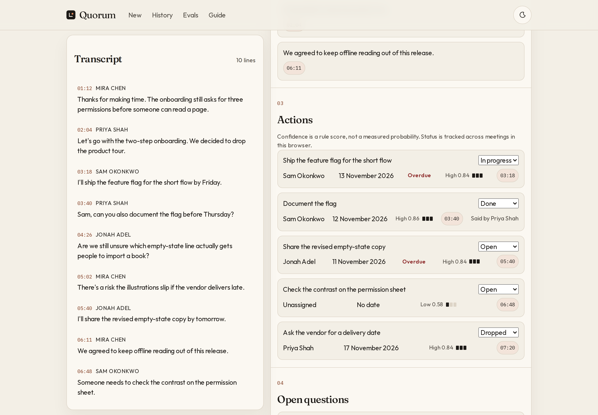
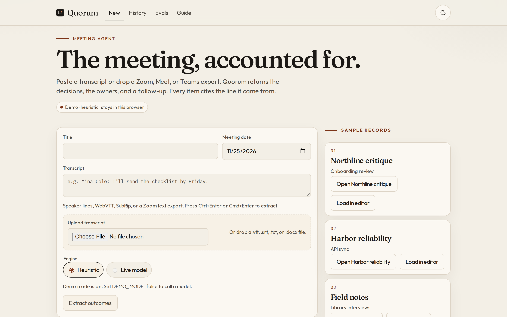
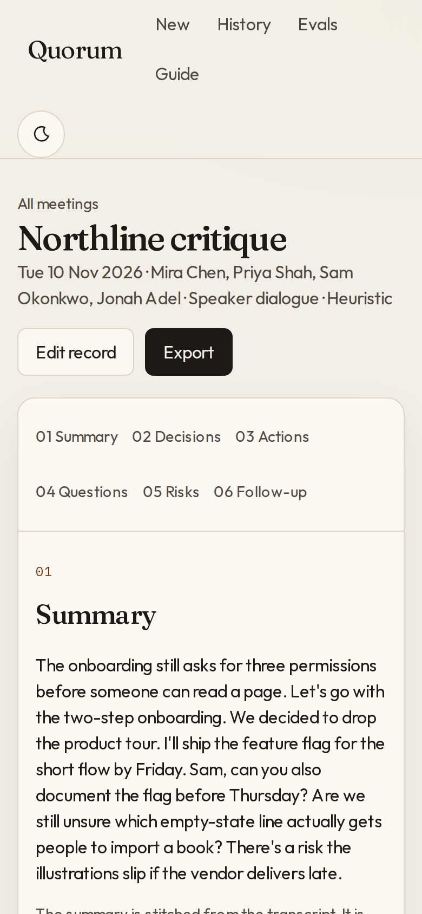
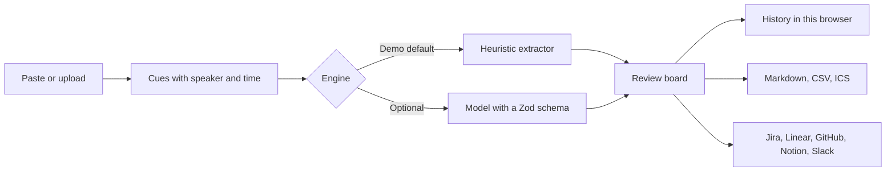
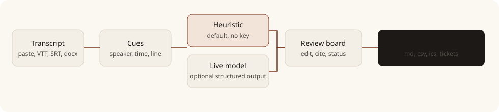

# Quorum

Turn a meeting transcript into decisions, owners, and a follow-up. Every item cites the line it came from.

Quorum is a local-first meeting agent for people who leave a call with a transcript and need the work, not another summary wall. Paste text, or upload a `.vtt`, `.srt`, `.txt`, or `.docx` export from Zoom, Meet, or Teams. The review board lists the summary, decisions, action items, open questions, risks, and a follow-up email. Action items carry an owner, a due date, and a rule score. History keeps their status across meetings.

**Demo mode is the default.** It needs no API key. A deterministic heuristic reads the transcript in the browser’s server, and four sample meetings are seeded on first open. A live model is optional.

**Live demo:** [akhilsingh2.github.io/meeting-actions-agent](https://akhilsingh2.github.io/meeting-actions-agent/). The hosted copy is a static build in demo mode with sample transcripts: the parser and heuristic extractor run in your browser, and exports are dry runs. Word uploads and live models need a local run. Build it with `STATIC_DEMO=true` (see `lib/demo`).



The home screen is the extractor. Sample records open a finished board, or you can load one back into the editor and run it again.



## What you can do

- Parse WebVTT (including Teams `<v>` tags), SubRip, Zoom’s timestamped text export, Meet’s speaker-then-timestamp export, `Name: text` dialogue, and Word documents.
- Attribute speakers, and tell “I’ll do it” apart from “Sam, can you”.
- Link every extracted item to a transcript line. Clicking the time scrolls to that line.
- Edit the record before anything leaves the page: text, owner, date, confidence band, status.
- Track open, in progress, done, and dropped items across meetings in this browser.
- Download Markdown, CSV, or an `.ics` calendar of deadlines.
- Preview Jira, Linear, GitHub Issues, Notion, and Slack requests. Demo mode stops before the network. With `DEMO_MODE=false` and credentials, the same payloads are sent.



## Architecture





The heuristic classifies sentences, fills owner and date, and keeps the source sentence as the citation. The optional model must return the same kind of structure. Unknown cue ids are dropped and the rule score is lowered. If the model call fails, Quorum uses the heuristic and says so. The follow-up email is rendered from the fields, so editing an owner can rebuild the draft without asking a model to rewrite prose.

## Eval set

`npm run eval` scores the heuristic on six checked-in transcripts (`lib/evals/gold.ts`). Five are explicit. One is an indirect assignment the rules are not expected to catch: “The design note needs a timeout budget from Leah before Monday.”

On that set, micro-averaged:

| Outcome | Precision | Recall | F1 | Gold items |
| --- | ---: | ---: | ---: | ---: |
| Actions | 100% | 93.3% | 96.6% | 15 |
| Decisions | 100% | 100% | 100% | 8 |
| Questions | 100% | 100% | 100% | 4 |
| Risks | 100% | 100% | 100% | 4 |

Owner and due date are both 100% on the actions that matched. Citation accuracy on matched items is 100%. These figures describe this set only. The Evals page in the app runs the same function.

`npm run eval:live` repeats the action score with a configured model. With no key, or with demo mode on, it prints a skip and exits 0.

## Run

```bash
npm install
npm run dev
```

Open [http://localhost:3000](http://localhost:3000). Load a sample record, or paste a transcript and extract. Nothing in demo mode calls a model or a ticket API.

```bash
npm test          # unit tests
npm run eval      # precision / recall table
npm run lint
npm run typecheck
npm run e2e       # Playwright, builds and serves the app
```

## Configure a live model or an exporter

Copy `.env.example` to `.env.local`. Placeholders only live in the example file. Set `DEMO_MODE=false` before any live call is allowed, then set `LLM_MODEL` and the provider key you intend to use.

| Variable | Role |
| --- | --- |
| `DEMO_MODE` | Anything other than `false` keeps the heuristic and dry-run exports. |
| `LLM_PROVIDER` | `openai`, `anthropic`, or `ollama`. |
| `LLM_MODEL` | Model id. Required for a live call. Quorum does not guess one. |
| `OPENAI_API_KEY` / `ANTHROPIC_API_KEY` | Provider credentials. |
| `OLLAMA_BASE_URL` | OpenAI-compatible endpoint, default `http://127.0.0.1:11434/v1`. |
| `JIRA_*` | One Jira issue per action. |
| `LINEAR_API_KEY`, `LINEAR_TEAM_ID` | One Linear issue per action. |
| `GITHUB_TOKEN`, `GITHUB_REPO` | `owner/name`. One GitHub issue per action. |
| `NOTION_TOKEN`, `NOTION_DATABASE_ID` | One page per action. The title property defaults to `Name`. The rest is written in the page body. |
| `SLACK_BOT_TOKEN`, `SLACK_CHANNEL_ID` | One message for the meeting. |

Ticket previews redact `Authorization`. The send path refuses non-HTTPS endpoints other than localhost.

## Deploy

The app is a Next.js project and runs on Vercel with no environment variables. Demo mode stays on, so the deployed site still works.

1. Import the repository in Vercel and leave the framework preset on Next.js.
2. Deploy. `npm run build` is the build command.
3. Add the variables above only when you want live extraction or live exports, and set `DEMO_MODE` to `false`.

Records stay in the browser’s `localStorage`. There is no database.

## Layout

```
app/                 routes, including extract and export handlers
components/          shell, composer, review board, history
lib/parse            VTT, SRT, Zoom, Meet, dialogue, docx
lib/extract          heuristic, dates, email draft
lib/llm              prompt, Zod schema, normalization, model call
lib/export           Markdown, CSV, ICS, and ticket payloads
lib/evals            gold set, scoring, report
lib/design           tokens and contrast checks
e2e/                 Playwright
docs/LEARNING.md     study guide
```

## Study guide

[docs/LEARNING.md](docs/LEARNING.md) is the walkthrough: cue normalization, why citations are data, structured output, the eval the heuristic fails on purpose, and exercises that extend the pipeline.

## License

MIT. Built by Akhilendra Singh.
